# Praktikum 7 — Pemrograman Server-Side dengan PHP

## Identitas Praktikum

| Keterangan | Informasi |
|---|---|
| Nama | Mu’ammar Kadafi |
| NIM | 312510192 |
| Program Studi / Semester | Teknik Informatika / 3 |
| Mata Kuliah | Pemrograman Web |
| Dosen Pengampu | Agung Nugroho, S.Kom., M.Kom. |
| Kelas | I253C |
| Hari / Tanggal | Sabtu, 14 November 2026 |
| Pertemuan | 9 (Online) |

## Tujuan Praktikum

1. Memahami perbedaan pemrosesan client-side dan server-side.
2. Mengenali sintaks PHP dan menjalankan file PHP melalui server lokal.
3. Menggunakan variabel, tipe data, operator, percabangan, perulangan, dan function.
4. Menerima dan memproses data dari formulir HTML menggunakan metode GET dan POST.
5. Melakukan validasi dan sanitasi input dasar sebelum data ditampilkan atau diproses.
6. Membangun aplikasi sederhana yang menerima, memproses, dan menampilkan data pengguna.

## Perangkat yang Digunakan

- Laptop / PC
- Web Browser
- Visual Studio Code
- PHP
- Server lokal (XAMPP / Laragon)

## Cara Menjalankan Server Lokal

1. Jalankan XAMPP Control Panel.
2. Aktifkan layanan Apache.
3. Simpan folder praktikum `lab7_php` di dalam direktori `htdocs`.
4. Buka browser.
5. Akses alamat berikut:

   ```text
   http://localhost/lab7_php/
   ```

## Struktur Folder

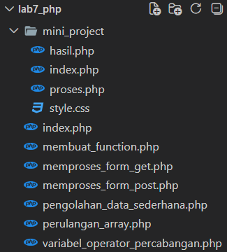

---

## Ringkasan Hasil Praktikum

### 1. Menjalankan PHP

**Langkah pengerjaan:**

1. Mempersiapkan text editor, misalnya Visual Studio Code.
2. Menginstal atau menyiapkan XAMPP/Laragon yang menyediakan PHP dan web server Apache/Nginx.
3. Membuat folder kerja dengan nama `lab7_php`.
4. Membuat file `index.php` dan menuliskan kode berikut.

**Kode program:**

```php
<!DOCTYPE html>
<html lang="id">

<head>
    <meta charset="UTF-8">
    <title>Praktikum PHP</title>
</head>

<body>
    <h1>Belajar PHP</h1>

    <?php
    echo "<p>PHP berhasil dijalankan.</p>";
    echo "<p>Waktu server: " . date("d-m-Y H:i:s") . "</p>";
    ?>

</body>
</html>
```

**Hasil praktikum:**

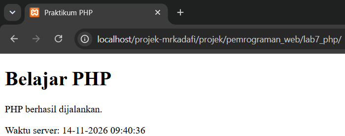

### 2. Variabel, Operator, dan Percabangan

**Langkah pengerjaan:**

Membuat file `variabel_operator_percabangan.php` untuk menghitung nilai akhir mahasiswa berdasarkan nilai tugas, UTS, dan UAS. Selanjutnya, menentukan predikat berdasarkan nilai akhir yang diperoleh.

**Kode program:**

```php
<?php
$nama = "Siti";
$tugas = 85;
$uts = 78;
$uas = 90;

$nilaiAkhir = ($tugas * 0.30) + ($uts * 0.30) + ($uas * 0.40);

if ($nilaiAkhir >= 85) {
    $predikat = "A";
} elseif ($nilaiAkhir >= 75) {
    $predikat = "B";
} elseif ($nilaiAkhir >= 60) {
    $predikat = "C";
} else {
    $predikat = "D";
}

echo "Nama: " . htmlspecialchars($nama) . "<br>";
echo "Nilai akhir: " . number_format($nilaiAkhir, 2) . "<br>";
echo "Predikat: " . $predikat;
?>
```

**Hasil praktikum:**

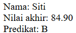

Pengujian dengan mengubah nilai tugas, UTS, dan UAS:

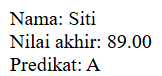

### 3. Perulangan dan Array

**Langkah pengerjaan:**

Membuat file `perulangan_array.php` untuk menampilkan daftar mahasiswa menggunakan array dan perulangan `foreach`.

**Kode program:**

```php
<?php
$mahasiswa = ["Alya", "Bima", "Citra", "Doni"];

echo "<h3>Daftar Mahasiswa</h3><ol>";

foreach ($mahasiswa as $nama) {
    echo "<li>" . htmlspecialchars($nama) . "</li>";
}

echo "</ol>";
?>
```

**Hasil praktikum:**

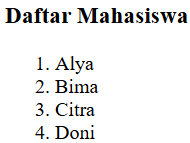

Pengujian setelah menambahkan tujuh nama mahasiswa:

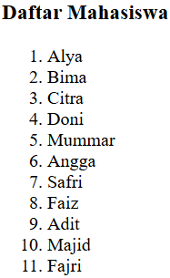

### 4. Function dalam PHP

**Langkah pengerjaan:**

Membuat file `membuat_function.php` untuk menghitung harga setelah mendapatkan diskon menggunakan function `hitungDiskon()`.

**Kode program:**

```php
<?php

function hitungDiskon($harga, $persen)
{
    $potongan = $harga * ($persen / 100);
    return $harga - $potongan;
}

$hargaAkhir = hitungDiskon(150000, 10);

echo "Harga setelah diskon: Rp" . number_format($hargaAkhir, 0, ",", ".");
?>
```

**Hasil praktikum:**

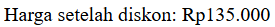

**Function tambahan untuk menentukan kelulusan mahasiswa:**

```php
function tentukanKelulusan($nilai)
{
    if ($nilai >= 75) {
        return "Lulus";
    } else {
        return "Tidak Lulus";
    }
}

$nilaiMahasiswa = 80;
$statusKelulusan = tentukanKelulusan($nilaiMahasiswa);

echo "<br>Nilai mahasiswa: " . $nilaiMahasiswa;
echo "<br>Status kelulusan: " . $statusKelulusan;
```

**Hasil praktikum:**

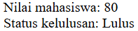

### 5. Formulir dengan Metode GET

**Langkah pengerjaan:**

Membuat file `memproses_form_get.php` untuk menerima kata kunci melalui formulir menggunakan metode GET. Data yang dikirim akan ditampilkan kembali menggunakan `htmlspecialchars()`.

**Kode program:**

```php
<form method="GET" action="">
    <label for="kata">Kata kunci:</label>
    <input id="kata" name="kata" type="text">
    <button type="submit">Cari</button>
</form>

<?php
if (isset($_GET["kata"])) {
    $kata = trim($_GET["kata"]);
    echo "Kata kunci: " . htmlspecialchars($kata, ENT_QUOTES, "UTF-8");
}
?>
```

**Hasil pengujian:**

Tampilan awal formulir:

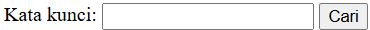

Pengujian ketika input dikosongkan:

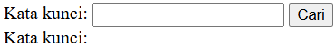

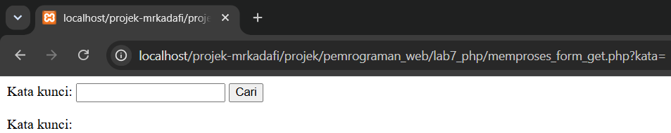

Pengujian setelah memasukkan kata kunci:

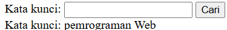

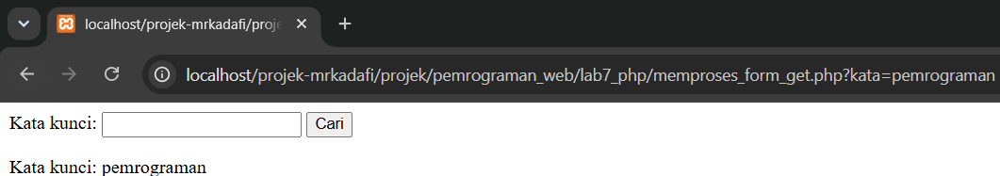

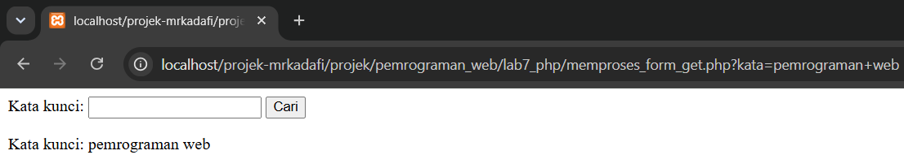

### 6. Formulir dengan Metode POST

**Langkah pengerjaan:**

Membuat file `memproses_form_post.php` untuk menerima nama dan program studi menggunakan metode POST. Data divalidasi sebelum ditampilkan kembali.

**Kode program:**

```php
<form method="POST" action="">
    <label for="nama">Nama:</label>
    <input id="nama" name="nama" type="text" required>

    <label for="prodi">Program Studi:</label>
    <input id="prodi" name="prodi" type="text" required>

    <button type="submit" name="kirim">Kirim Data</button>
</form>

<?php
if ($_SERVER["REQUEST_METHOD"] === "POST") {
    $nama = trim($_POST["nama"] ?? "");
    $prodi = trim($_POST["prodi"] ?? "");

    if ($nama === "" || $prodi === "") {
        echo "<p>Semua kolom wajib diisi.</p>";
    } else {
        echo "<h3>Data diterima</h3>";
        echo "Nama: " . htmlspecialchars($nama, ENT_QUOTES, "UTF-8") . "<br>";
        echo "Program Studi: " . htmlspecialchars($prodi, ENT_QUOTES, "UTF-8");
    }
}
?>
```

**Hasil pengujian:**

Tampilan awal formulir:

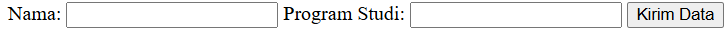

Pengujian pengiriman data lengkap:

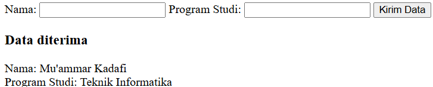

Pengujian ketika input dikosongkan:

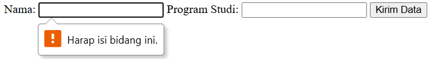

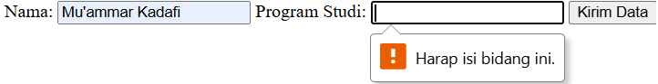

Pengujian input karakter khusus, seperti tanda kutip dan tag HTML:

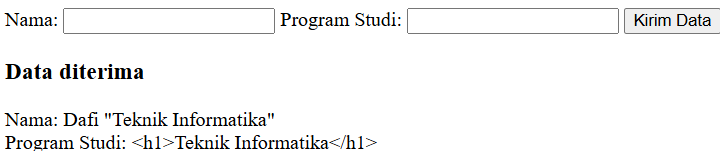

### 7. Pengolahan Data Sederhana

**Langkah pengerjaan:**

Membuat file `pengolahan_data_sederhana.php` untuk menerima nama barang, harga, dan jumlah. PHP akan melakukan validasi data, menghitung subtotal, dan menampilkan ringkasan transaksi.

**Kode program:**

```php
<?php

$barang = "";
$subtotal = null;
$error = null;

if ($_SERVER["REQUEST_METHOD"] === "POST") {
    $barang = trim($_POST["barang"] ?? "");
    $hargaInput = $_POST["harga"] ?? "";
    $jumlahInput = $_POST["jumlah"] ?? "";

    if (
        $barang === "" || !is_numeric($hargaInput) ||
        !ctype_digit((string)$jumlahInput) ||
        (float)$hargaInput < 0 || (int)$jumlahInput < 1
    ) {
        $error = "Periksa kembali nama barang, harga, dan jumlah.";
    } else {
        $harga = (float)$hargaInput;
        $jumlah = (int)$jumlahInput;
        $subtotal = $harga * $jumlah;
    }
}
?>

<form method="POST">
    <label>
        Nama barang
        <input name="barang" required>
    </label>

    <label>
        Harga
        <input name="harga" type="number" min="0" step="0.01" required>
    </label>

    <label>
        Jumlah
        <input name="jumlah" type="number" min="1" step="1" required>
    </label>

    <button type="submit">Hitung</button>
</form>

<?php
if (isset($error)) {
    echo "<p>" . htmlspecialchars($error) . "</p>";
} elseif (isset($subtotal)) {
    echo "<p>Barang: " . htmlspecialchars($barang) . "</p>";
    echo "<p>Subtotal: Rp" . number_format($subtotal, 0, ",", ".") . "</p>";
}
?>
```

**Hasil pengujian:**

Tampilan awal pengolahan data:

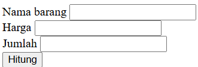

Pengujian menggunakan harga desimal:

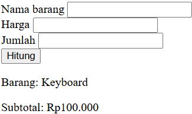

Pengujian jumlah nol:

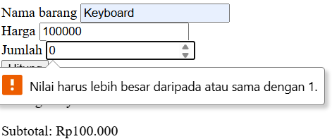

Pengujian jumlah negatif:

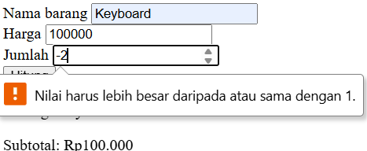

Pengujian dengan data yang tidak sesuai:

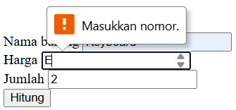

### 8. Mini Project — Aplikasi Formulir Data Mahasiswa

**Deskripsi:**

Membuat aplikasi sederhana untuk menerima, memvalidasi, dan menampilkan ringkasan data mahasiswa. Aplikasi menggunakan metode POST serta validasi server-side untuk memastikan data yang diterima sesuai dengan ketentuan.

**Fitur aplikasi:**

1. Formulir input nama lengkap, NIM, program studi, semester, dan email.
2. Pengiriman data menggunakan metode POST.
3. Validasi kolom wajib diisi.
4. Validasi semester berupa bilangan bulat dalam rentang 1–14.
5. Validasi format email.
6. Penggunaan `htmlspecialchars()` untuk mengamankan data sebelum ditampilkan.
7. Pemisahan file formulir, pemrosesan data, dan tampilan hasil.

**Struktur file Mini Project:**

```text
mini_project/
├── index.php
├── proses.php
├── hasil.php
└── style.css
```

**Alur aplikasi:**

- `index.php` — menampilkan formulir data mahasiswa.
- `proses.php` — menerima dan memvalidasi data yang dikirim menggunakan POST.
- `hasil.php` — menampilkan ringkasan data mahasiswa jika seluruh validasi berhasil.
- `style.css` — mengatur tampilan aplikasi dengan warna hijau dan putih.

**Alamat untuk menjalankan aplikasi:**

```text
http://localhost/lab7_php/mini_project/
```

**Hasil praktikum:**

Tampilan mini project seperti gambar berikut.

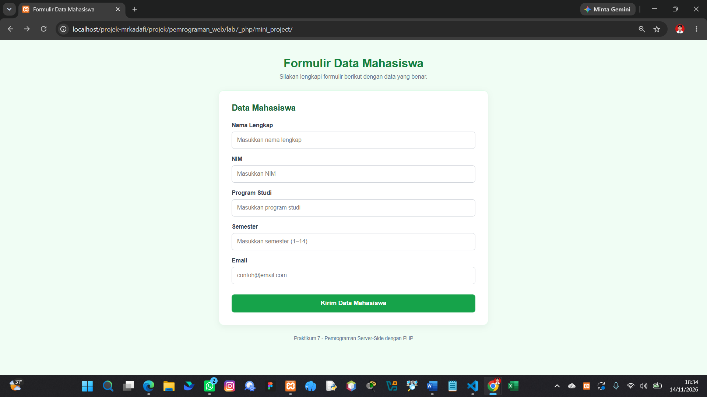

Tampilan input kosong seperti gambar berikut. 

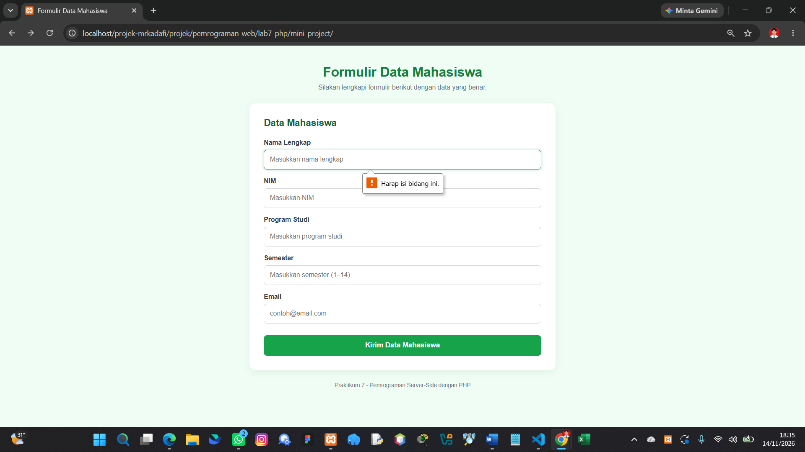

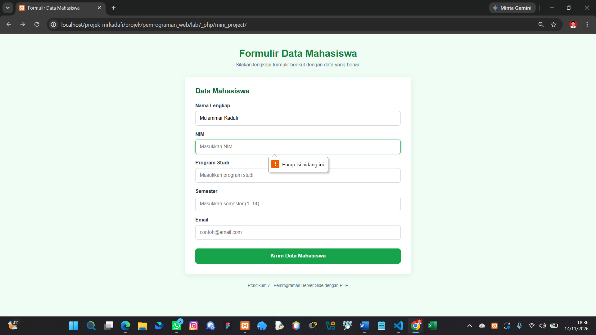

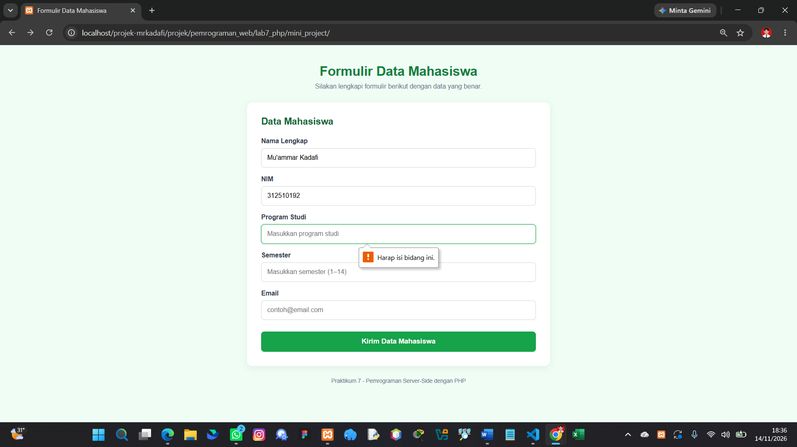

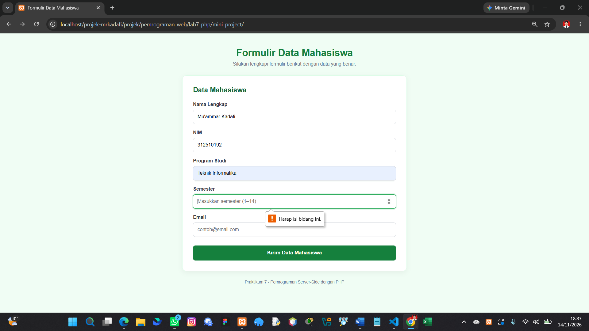

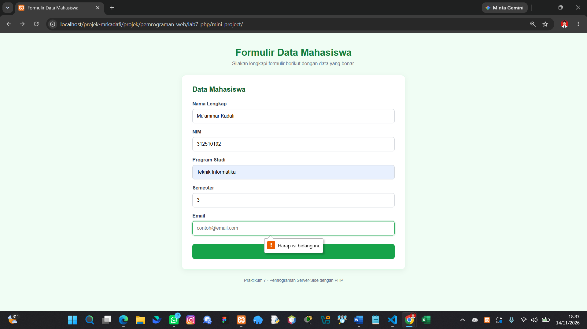

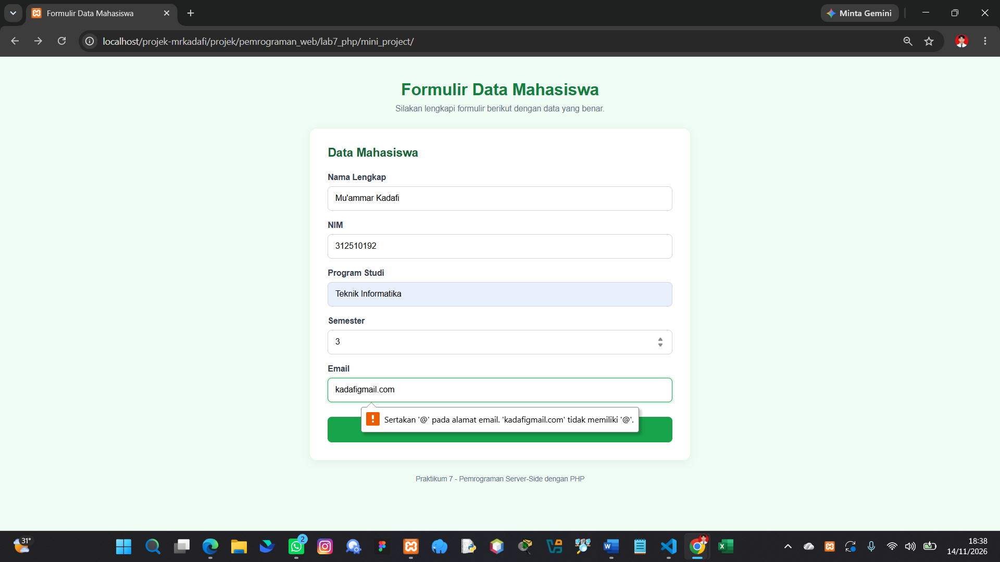

Tampilan ringkasan data mahasiswa seperti gambar berikut.

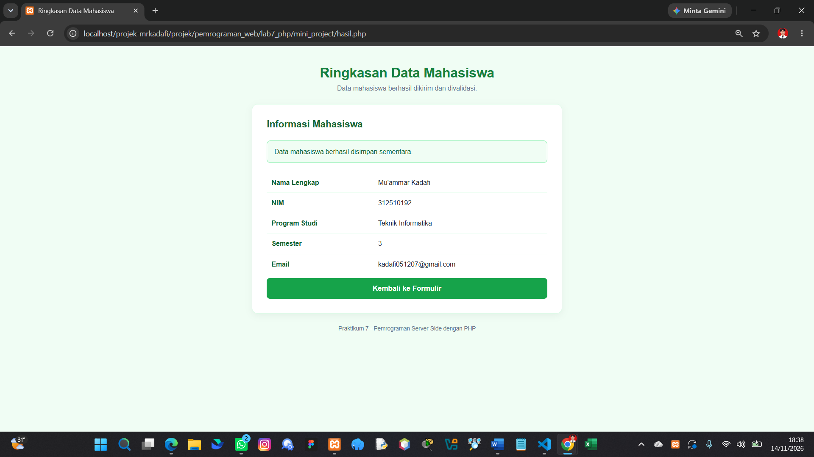
